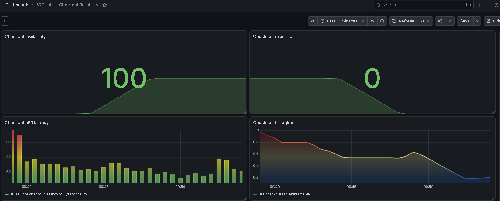
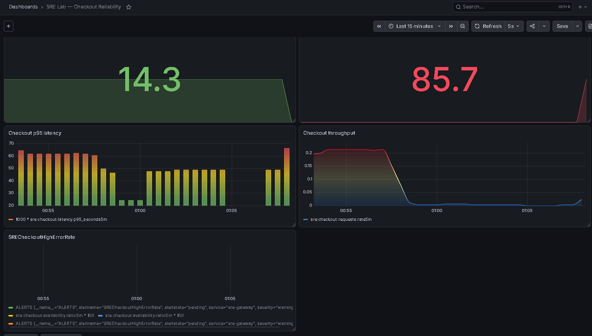
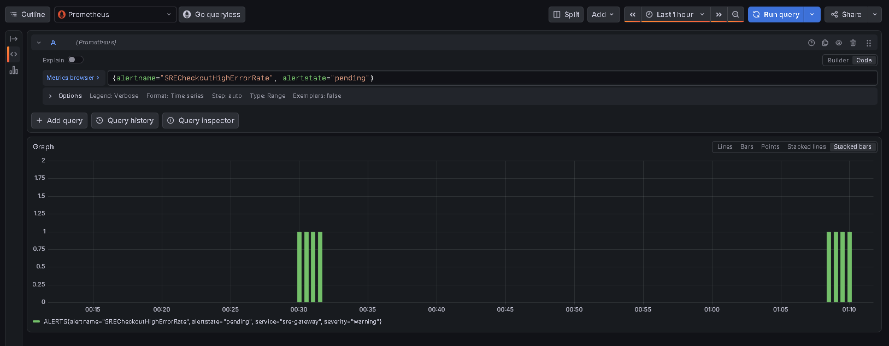
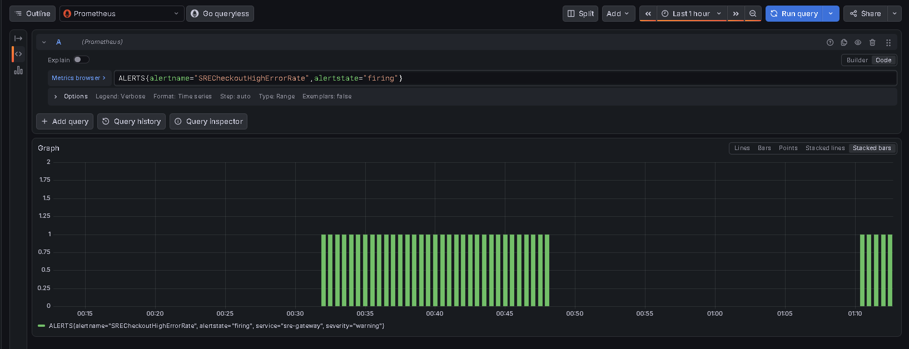
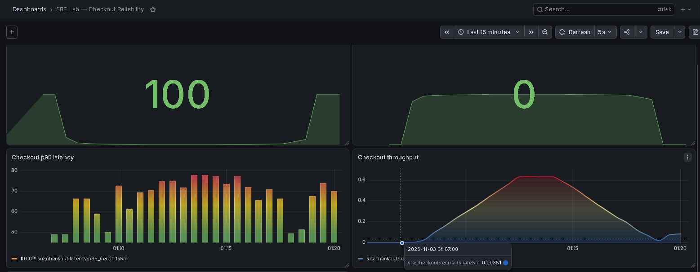
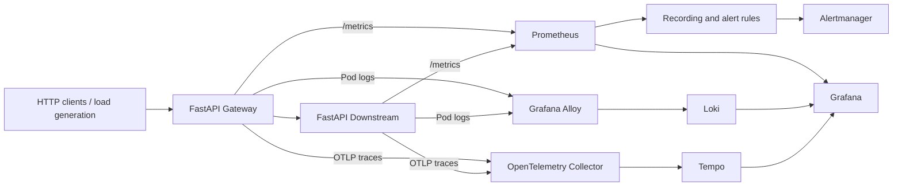
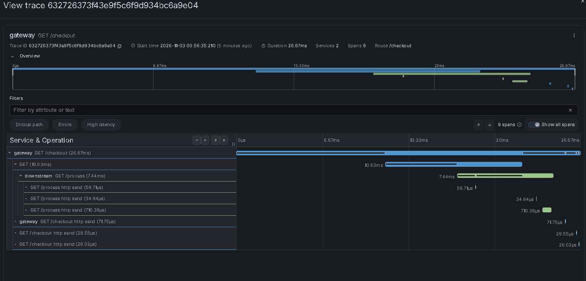
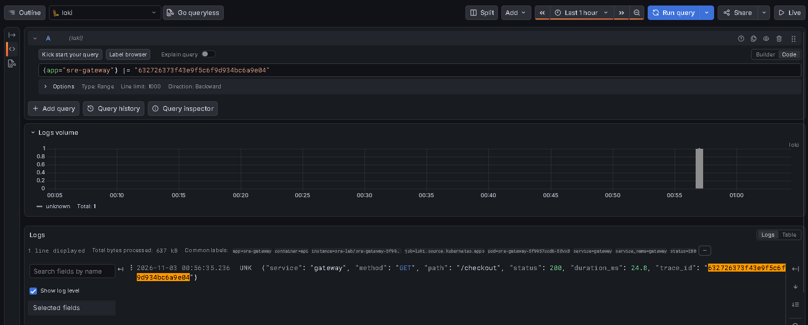
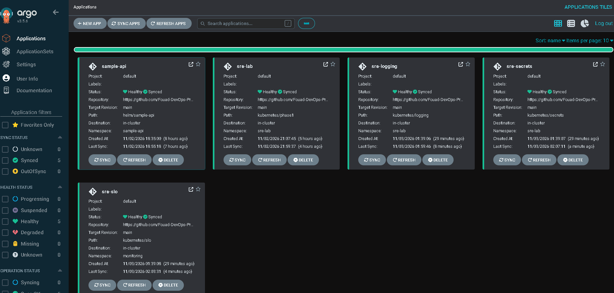

# 🔭 Observability & Resilience Platform

**From a successful checkout to a failing dependency, a firing SLO alert, and a verified recovery — on a real GKE cluster.**

> **Scope:** A verified, single-node **portfolio lab**, not a highly available production platform. The figures below are **observed test-window results**, not long-term service guarantees.

## At a glance

| SRE capability | Verified outcome |
|---|---|
| **Golden signals** | Checkout availability, 5xx rate, p95 latency and request throughput |
| **Distributed tracing** | End-to-end `gateway → downstream` trace in Tempo (2 services, 9 spans) |
| **Log correlation** | Same trace ID found in Loki and Tempo |
| **Incident detection** | `SRECheckoutHighErrorRate` observed **Pending → Firing** |
| **Controlled outage** | Checkout availability **14.3%**, HTTP 5xx **85.7%** in a sampled 5-minute window |
| **Recovery** | HTTP 200; checkout availability **100%**, 5xx **0%** after recovery |
| **Troubleshooting** | Tempo OOMKilled (exit 137), remediated by increasing memory limit from 384Mi to 1Gi |
| **Security** | Private GHCR pull secret sourced from GCP Secret Manager via External Secrets and Workload Identity |

## Incident drill: detect → respond → recover

| Healthy baseline | Degraded checkout |
|---|---|
|  |  |

| Alert pending | Alert firing |
|---|---|
|  |  |

**What happened:** `FORCE_FAILURE=true` on the downstream service triggered HTTP 503 at `/process`. The gateway propagated the dependency failure as HTTP 503 at `/checkout`. Prometheus recorded the checkout impact, evaluated a two-minute alert condition, and transitioned through Pending and Firing. Removing the injection restored successful checkouts and the alert resolved after the rolling window cleared.

[Read the incident report](docs/incidents/incident-report.md) · [Review alert rules](kubernetes/slo/checkout-rules.yaml)

## Architecture

**Infrastructure:** Google Kubernetes Engine; Argo CD for reconciliation; GHCR for the API image; External Secrets Operator + GCP Secret Manager + Workload Identity for the image-pull secret. Prometheus, Grafana and Alertmanager are reused from the existing monitoring installation.

## Observability in action

| Two-service distributed trace | Same trace ID in structured logs |
|---|---|
|  |  |

The application exposes `sre_http_requests_total` and `sre_http_request_duration_seconds`. Its instrumented client calls send traces through the OTLP collector to Tempo. Grafana Alloy collects Kubernetes Pod logs into Loki. An actual trace ID was verified in **both** Loki and Tempo.

**Prometheus label detail:** Due to target label collisions, the application's `service="gateway"` is stored as `exported_service="gateway"`. The committed SLO rules use the verified label.

**Lab SLO thresholds:** 99.5% server-side checkout availability, 5xx under 0.5%, p95 under 500 ms. These measure requests that reach the gateway; an absence of traffic is *not* evidence of 100% availability. Alerts require at least 10 checkout requests in five minutes and two minutes of sustained violation.

## GitOps: 5/5 Synced & Healthy

**Verified on GKE:** All five Applications reached Synced / Healthy.
The three SRE add-ons were adopted through reviewed, manual syncs
without disrupting Loki, Alloy, or the application's running Pods.

## GitOps delivery

| Git-managed configuration | Path | Deployment |
|---|---|---|
| Gateway, downstream, Tempo, OTEL, ServiceMonitor | [`kubernetes/phase1`](kubernetes/phase1/) | Argo CD `sre-lab` |
| Loki, Alloy, namespace-scoped RBAC | [`kubernetes/logging`](kubernetes/logging/) | Argo CD `sre-logging` (adopted and verified) |
| SecretStore, ExternalSecret, reader ServiceAccount | [`kubernetes/secrets`](kubernetes/secrets/) | Argo CD `sre-secrets` (adopted and verified) |
| Recording rules and SLO alerts | [`kubernetes/slo`](kubernetes/slo/) | Argo CD `sre-slo` (adopted and verified) |

**Verified adoption:** The logging, secrets and SLO Applications were initially synchronized manually after reviewing live-resource diffs. The desired configuration now enables automatic self-healing with `prune: false`. See the [adoption runbook](docs/gitops-adoption.md) for prerequisites and the controlled adoption procedure.

### Reproduce

1. Deploy the prerequisite **Prometheus Operator**, Argo CD, External Secrets Operator and configured GCP Secret Manager IAM/Workload Identity. Ensure the existing GHCR credentials remain **outside Git**.
2. Build and publish the API image using [GitHub Actions](.github/workflows/ci.yml); verify access to the private GHCR image.
3. Follow [GKE deployment](docs/gke-deploy.md) for the base app and [GitOps adoption](docs/gitops-adoption.md) for the add-ons.
4. Import [Grafana dashboard (classic JSON)](grafana/dashboards/checkout-slo-dashboard.json). The [Grafana Dashboard API v2 resource](grafana/dashboards/checkout-slo-dashboard-v2.json) is also preserved.
5. Reproduce the incident only in a disposable lab, following the rollback steps in the [incident report](docs/incidents/incident-report.md).

**Local application development:** `docker compose up -d --build`, then `curl http://localhost:8000/checkout`. The GKE observability integration relies on the existing in-cluster monitoring stack; local Compose is not a substitute for the validated GKE exercise.

## Reproducible load & resilience testing

**Beyond screenshots:** the repository now contains two bounded k6 profiles and automated Python fault-response checks.

| Validation | Coverage |
|---|---|
| **CI checkout smoke** | 2 k6 VUs, 15s, HTTP 200 payload checks, p95 <500ms and failure rate <0.5% |
| **Opt-in baseline** | 3 arrivals/s for 60s with a strict 10-VU cap and dropped-iteration threshold |
| **Resilience regression** | HTTP 500/503, connection failure, timeout, malformed payload, recovery to 200 |
| **Safety guardrails** | No CI mutations to GKE; baseline requires explicit opt-in and targets a lab only |

[Run load and resilience checks](docs/load-resilience.md) · [k6 smoke](tests/load/smoke.js) · [k6 baseline](tests/load/baseline.js) · [Fault-response tests](apps/tests/test_resilience.py)

> These tests are implemented as repeatable validation gates; live performance figures must come from a completed test run, not the configured thresholds.

## Engineering decisions & limitations

- **Data persistence:** Tempo and Loki use `emptyDir`; Pod replacement can erase telemetry. No production retention guarantee or HA is claimed.
- **Alerting:** Prometheus Pending/Firing/Resolved states were verified; **external Alertmanager notification delivery was not tested**.
- **Scalability:** The lab used one GKE worker. HA, durable storage, autoscaling and GKE capacity benchmarking remain future work. CI smoke and bounded load-test scripts are available; a GKE load-test result has not been recorded.
- **Resource safety:** Tempo's original 384Mi limit caused an actual OOM; the 1Gi remediation was deployed and verified.
- **Security:** Loki is internal-only without authentication. Keep any port-forwards local, protect Grafana, and never commit registry or cloud credentials.
- **Cloud cost:** The GKE cluster is billable until explicitly torn down; follow the infrastructure cleanup instructions when evidence collection is finished.

## Project references

[Deployment guide](docs/gke-deploy.md) · [Safe GitOps adoption](docs/gitops-adoption.md) · [Incident report](docs/incidents/incident-report.md) · [Original experiment plan](docs/experiments.md) · [Dashboard JSON](grafana/dashboards/checkout-slo-dashboard.json)
