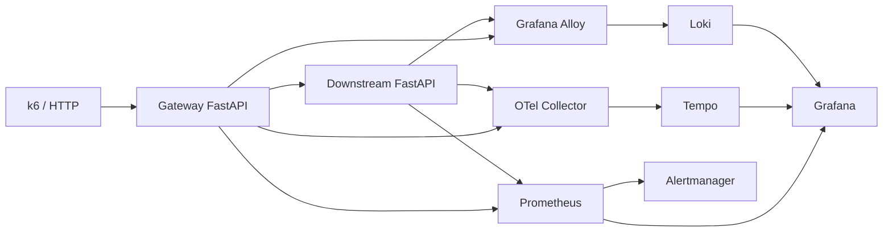

# Observability & Resilience Platform Lab

A hands-on SRE portfolio project for **metrics, structured logs, distributed tracing, load testing, service-level objectives and controlled failure recovery**.

**Status:** Initial implementation committed; real deployments, dashboards and failure tests must be validated before claiming success.

## Goal

Build two Python FastAPI services and observe a request end to end using Prometheus, Grafana, Loki, Tempo, OpenTelemetry and k6. Use Docker Compose locally to avoid cloud charges.

## Architecture



## Getting started

```bash
docker compose up -d --build
docker compose ps
curl http://localhost:8000/health/ready
curl http://localhost:8000/checkout
```

- Gateway: http://localhost:8000
- Grafana: http://localhost:3000 (local lab initial credentials: admin / admin)
- Prometheus: http://localhost:9090
- Alertmanager: http://localhost:9093

See [experiments and evidence plan](docs/experiments.md) after the initial implementation is added. Do not publish screenshots or results from an untested deployment as though verified.

---

## Observability and Resilience Evidence

The platform implements centralized logs, distributed tracing,
application SLO measurements, and automated Prometheus alerts.

### Healthy checkout dashboard


### Distributed tracing


### Log-to-trace correlation


### Failure injection and SLO degradation


### Alert transitions

| Pending | Firing |
|---|---|
|  |  |

### Recovery


### Reproducible configuration

- [Grafana SLO dashboard](grafana/dashboards/checkout-slo-dashboard.json)
- [Prometheus alert rules](kubernetes/slo/checkout-rules.yaml)
- [Loki and Alloy manifests](kubernetes/logging/)
- [Incident response report](docs/incidents/incident-report.md)

> The experiment demonstrated Prometheus alert evaluation
> and recovery. External Alertmanager notifications were not tested.
