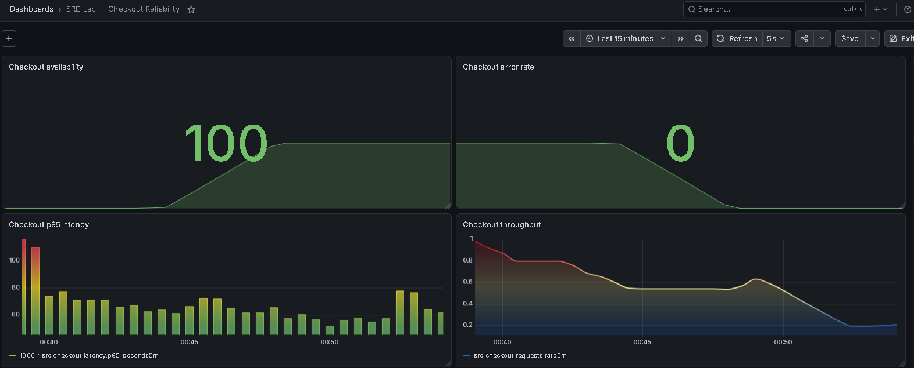
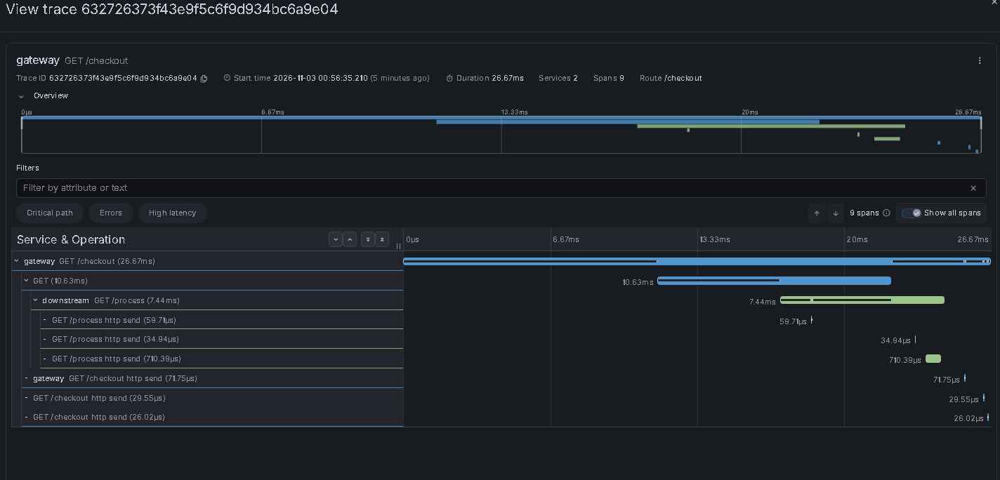
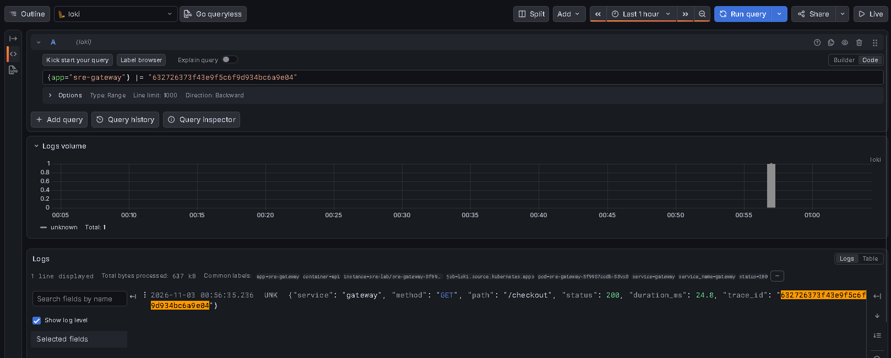
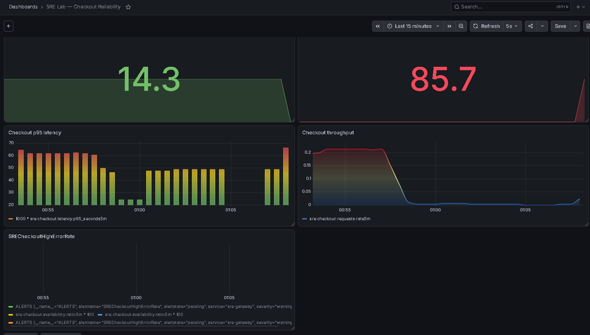
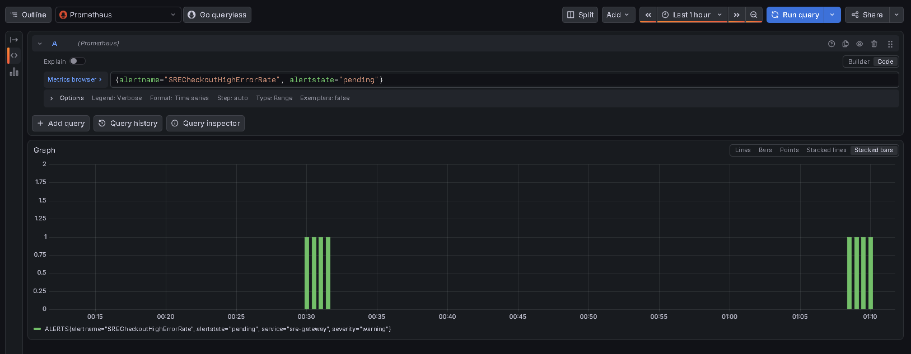
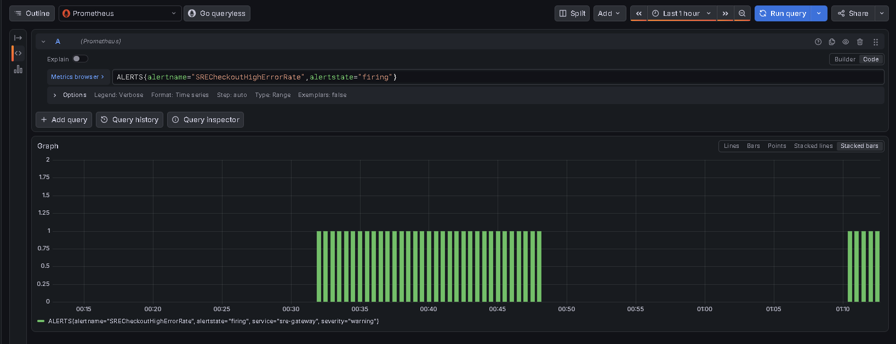
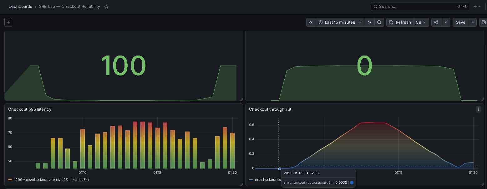

# SRE Incident Response Report

## Environment

- Platform: Google Kubernetes Engine (GKE)
- Application: Gateway and downstream FastAPI services
- Observability: Prometheus, Grafana, Loki, Alloy, Tempo
- Deployment management: Argo CD

## Incident 1: Tempo Out of Memory

### Symptoms
- Grafana Tempo queries returned connection refused.
- Tempo entered CrashLoopBackOff.
- Tempo Service had no ready endpoints.

### Root Cause
Kubernetes reported:
- Reason: OOMKilled
- Exit code: 137
- Original memory limit: 384Mi

### Remediation
Updated the Tempo Deployment through GitOps:
- Memory request: 160Mi -> 384Mi
- Memory limit: 384Mi -> 1Gi

### Verification
- Deployment successfully rolled out.
- Tempo Pod returned to Running.
- Distributed tracing was verified across gateway and downstream.
- Argo CD reported Synced and Healthy.

## Incident 2: Controlled Downstream Failure

### Objective
Verify failure detection, SLO monitoring, alerting,
and application recovery.

### Failure Injection
Enabled FORCE_FAILURE=true on the downstream Deployment.

The downstream returned HTTP 503, propagated through
the gateway checkout endpoint.

### Observed Impact
- Checkout availability dropped to 14.3%.
- HTTP 5xx error rate increased to 85.7%.
- Prometheus alert SRECheckoutHighErrorRate entered Pending.
- The alert subsequently entered Firing.

### Recovery
- Removed FORCE_FAILURE.
- Successfully rolled out the downstream Deployment.
- Restored Argo CD selfHeal=true.
- Verified HTTP 200 checkout responses.
- Verified Argo CD Synced and Healthy.
- Confirmed the Prometheus alert was no longer active.
- Checkout availability recovered to 100% with 0% HTTP 5xx errors.

### Lessons Learned
- Dependency failures can directly affect API availability.
- Application metrics must use the correct Prometheus labels.
- Alert evaluation must be tested, not just rule deployment.
- Recovery includes both application health and alert resolution.
- Controlled experiments must include explicit rollback steps.

## Limitations
- This was a controlled lab experiment, not a production outage.
- Alertmanager notification delivery was not verified.
- Tempo and Loki use ephemeral storage.
- The SLO measurements use five-minute observation windows.

## Evidence

