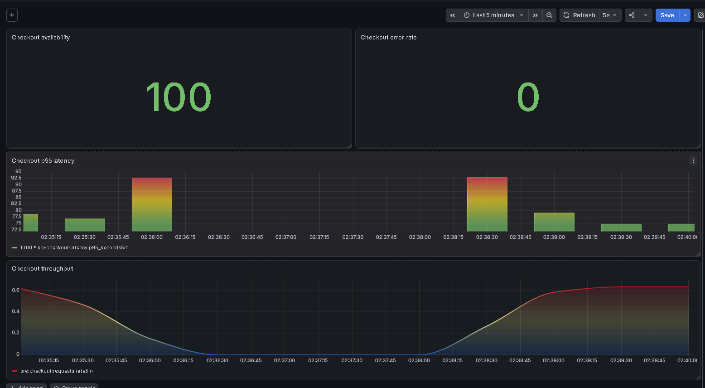

# GKE Checkout Performance Benchmark

## Executive Summary

The checkout service successfully completed a bounded k6
performance test against the running GKE deployment.

**Result: PASS — all four k6 thresholds satisfied.**

## Test Configuration

| Parameter | Value |
|---|---|
| Target | GKE gateway through kubectl port-forward |
| Endpoint | GET /checkout |
| Duration | 60 seconds |
| Arrival rate | 3 requests/second |
| Maximum configured VUs | 10 |
| Requests completed | 180 |
| Dropped iterations | 0 |

## Measured Results

| Metric | Result |
|---|---|
| Requests | 180 |
| HTTP success rate | 100% |
| Error rate | 0.00% |
| Throughput | 3.00 requests/second |
| Average latency | 196.76 ms |
| Median latency | 169.55 ms |
| p90 latency | 246.96 ms |
| p95 latency | 288.77 ms |
| Maximum latency | 622.39 ms |
| Successful checks | 360/360 |
| Dropped iterations | 0 |

## Threshold Validation

| Threshold | Result |
|---|---|
| Check success rate >99% | PASS |
| HTTP failure rate <0.5% | PASS |
| HTTP p95 <500 ms | PASS |
| Dropped iterations = 0 | PASS |

## Grafana Evidence

## Raw Evidence

- [k6 console output](../evidence/k6-baseline-output.txt)
- [k6 JSON summary](../evidence/k6-baseline-results.json)
- [k6 test script](../../tests/load/baseline.js)

## Limitations

This was a bounded baseline test, not a maximum capacity
or stress test. Results include WSL-to-GKE port-forward
network overhead and cannot be interpreted as isolated
server-side processing latency.

The test lasted one minute and does not demonstrate
long-term availability or scalability.

After the test, all six SRE Pods were Running with
zero restarts, and all five Argo CD Applications
were Synced and Healthy.

## Second Benchmark — Repeatability

The benchmark was repeated using the same bounded k6 configuration.

| Metric | Run 1 | Run 2 |
|---|---:|---:|
| Completed requests | 180 | 181 |
| Throughput | 3.000 req/s | 3.008 req/s |
| Average latency | 196.76 ms | 187.60 ms |
| p95 latency | 288.77 ms | 259.52 ms |
| HTTP failure rate | 0% | 0% |
| Dropped iterations | 0 | 0 |
| Thresholds passed | 4/4 | 4/4 |

Both runs passed all thresholds. The second run recorded a lower
p95 latency, but two short tests are insufficient to establish a
statistically significant performance improvement.

The Grafana throughput panel uses a five-minute Prometheus rate.
Consequently, a one-minute test at approximately 3 requests/second
can appear as approximately 0.6 requests/second when averaged over
five minutes.

### Second-run evidence

- [k6 rerun console output](../evidence/k6-baseline-rerun-output.txt)
- [k6 rerun JSON summary](../evidence/k6-baseline-rerun-results.json)

